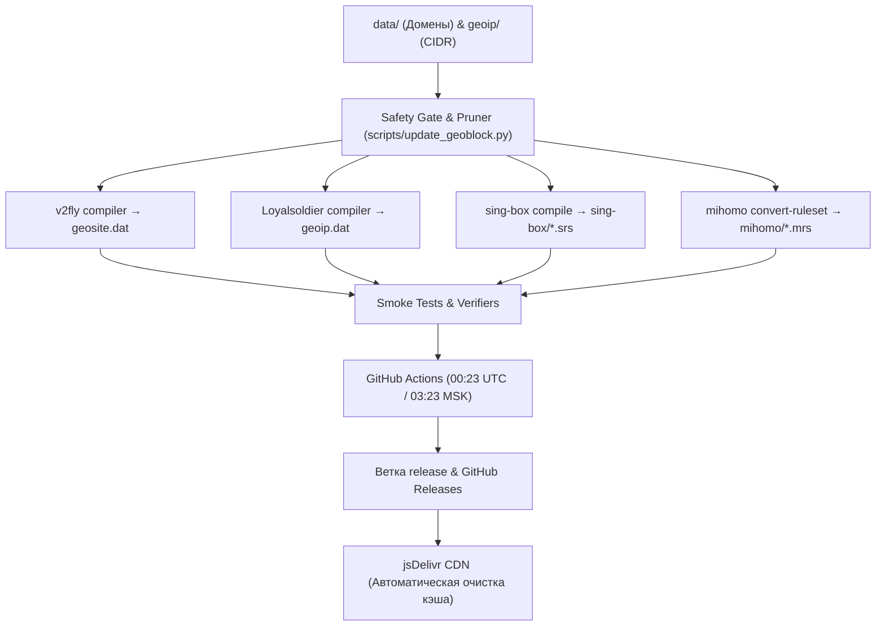

<div align="center">

# 🚀 коридор роутинг

**Наборы правил маршрутизации и конфигурации раздельного туннелирования (Split Tunneling) для [«коридор»](https://mvrvntn.github.io/koridor/), [Happ](https://happ.su), [INCY](https://incy.cc), [Mihomo](https://github.com/MetaCubeX/mihomo), [Sing-box](https://github.com/SagerNet/sing-box) и [Remnawave](https://docs.rw).**

[](https://github.com/mvrvntn/routing/actions/workflows/update-configs.yml)
[](https://github.com/mvrvntn/routing/releases/latest)
[](https://www.jsdelivr.com/package/gh/mvrvntn/routing)
[](tests/)
[](LICENSE)

**Регион:** 🇷🇺 Россия + 🇧🇾 Беларусь

</div>

---

<details>
<summary><b>📑 Оглавление</b></summary>

- [Как это работает](#как-это-работает)
- [Профили маршрутизации](#профили-маршрутизации)
- [Быстрый импорт в клиенты](#быстрый-импорт-в-клиенты)
- [Маршрутизация Discord](#маршрутизация-discord-webrtc-voice-video)
- [Интеграция с серверными панелями](#интеграция-с-серверными-панелями)
- [Ссылки на скомпилированные базы и Rule-Sets](#ссылки-на-скомпилированные-базы-и-rule-sets)
- [Структура репозитория](#структура-репозитория)
- [Утилиты генерации правил](#утилиты-генерации-правил)
- [Локальная разработка и CI/CD](#локальная-разработка-архитектура-и-cicd)
- [Предложить домен или маршрут](#предложить-домен-или-маршрут)
- [FAQ](#faq)
- [Благодарности и поддержка](#благодарности-и-поддержка)
- [Лицензия и дисклеймер](#лицензия-и-дисклеймер)

</details>

---

## Как это работает

* 🇷🇺 **Прямое соединение (Direct):** Государственные порталы, банки (Сбер, Т-Банк, ВТБ), Налоговая служба, СБП, маркетплейсы (Ozon, WB), сервисы Яндекса, VK, Кинопоиск, сетевые игры (Steam, Epic, Riot) и диагностические чекеры (`ipwho.is`, `2ip.ru`). Трафик идет через локального провайдера с минимальной задержкой (RTT) на полной скорости тарифа.
* 🌍 **Через прокси-узел (Proxy):** YouTube, Discord (включая прямые UDP-диапазоны голосовых серверов), Telegram, AI-платформы (ChatGPT, Claude, Gemini, Perplexity), а также сервисы с геоблокировкой РФ и реестровые ограничения.
* ⚡ **Оптимизированная база (~96 КБ):** База сжата алгоритмом агрегации поддоменов (`geosite.dat` ~96.5 КБ, потребление памяти ~1.8 МБ RAM). Снижает нагрузку на CPU мобильных устройств и предотвращает сбросы сетевого расширения на iOS.
* 🎮 **Игровой трафик (CDN & Matchmaking Bypass):** Поддерживаются голосовой движок Vivox (`vivox.com`), платформы Steam, Battle.net, Epic Games, Riot, Tarkov, Roblox, Call of Duty (Ricochet). Скачивание обновлений и дистрибутивов игр принудительно направляется напрямую (`DIRECT`), а замер пинга в матчах защищен от задержек Fake-IP (SDR / STUN bypass).
* 🛡 **Safety Gate:** Домены национальных зон `.ru`, `.рф`, `.su` и критическая инфраструктура защищены от случайного проксирования на уровне линтеров репозитория и фильтрации CI/CD.

---

## Профили маршрутизации

| Профиль | Назначение | Happ (iOS / Android / Desktop) | INCY (iOS / Android / Desktop) | Mihomo / Clash | Shadowrocket (iOS) |
| :--- | :--- | :--- | :--- | :--- | :--- |
| **DEFAULT**<br>*(Основной)* | **Рекомендуемый для повседневного использования.** Раздельное туннелирование: РФ-сервисы, банки, доставка и игры — напрямую; YouTube, Discord, AI и внешние ресурсы — через прокси. | [⚡ DeepLink](HAPP/DEFAULT.DEEPLINK)<br>[📄 JSON](HAPP/DEFAULT.JSON) | [☁️ Autorouting](INCY/DEFAULT.AUTOROUTING)<br>[⚡ DeepLink](INCY/DEFAULT.DEEPLINK) | [📄 Конфиг](MIHOMO/default.yaml) | [☁️ CDN](https://cdn.jsdelivr.net/gh/mvrvntn/routing@main/SHADOWROCKET/DEFAULT.CONF)<br>[📄 CONF](SHADOWROCKET/DEFAULT.CONF) |
| **JSONSUB**<br>*(Для подписок)* | **Базовый профиль для серверов и панелей.** Содержит изолированные DoH DNS и ссылки на геобазы; правила маршрутизации считываются из JSON-конфигурации подписки. | [⚡ DeepLink](HAPP/JSONSUB.DEEPLINK)<br>[📄 JSON](HAPP/JSONSUB.JSON) | [☁️ Autorouting](INCY/JSONSUB.AUTOROUTING)<br>[⚡ DeepLink](INCY/JSONSUB.DEEPLINK) | — | — |
| **WHITELIST**<br>*(Белый список)* | **Аварийный профиль прямого доступа.** Направляет напрямую **исключительно** критическую инфраструктуру РФ (Госуслуги, Банки, СБП, связь, маркетплейсы, РЖД). Предназначен для работы в условиях жестких сетевых сбоев. | [⚡ DeepLink](HAPP/WHITELIST.DEEPLINK)<br>[📄 JSON](HAPP/WHITELIST.JSON) | [☁️ Autorouting](INCY/WHITELIST.AUTOROUTING)<br>[⚡ DeepLink](INCY/WHITELIST.DEEPLINK) | [📄 Шаблон](MIHOMO/template_whitelist.yaml) | [☁️ CDN](https://cdn.jsdelivr.net/gh/mvrvntn/routing@main/SHADOWROCKET/WHITELIST.CONF)<br>[📄 CONF](SHADOWROCKET/WHITELIST.CONF) |
| **RELOCANT**<br>*(Релокант)* | **Обратный сплит-туннель (Reverse Split).** Для тех, кто находится **за пределами РФ**. Весь мировой интернет идёт напрямую, и только сервисы РФ (Госуслуги, банки РФ, Кинопоиск, Faceit RU) идут через российский прокси-сервер. | [⚡ DeepLink](RELOCANT/HAPP.DEEPLINK)<br>[📄 JSON](RELOCANT/HAPP.JSON) | [☁️ Autorouting](RELOCANT/INCY.AUTOROUTING)<br>[⚡ DeepLink](RELOCANT/INCY.DEEPLINK) | [📄 Конфиг](RELOCANT/mihomo.yaml) | [☁️ CDN](https://cdn.jsdelivr.net/gh/mvrvntn/routing@main/SHADOWROCKET/RELOCANT.CONF)<br>[📄 CONF](RELOCANT/SHADOWROCKET.CONF) |

> [!NOTE]
> Подробное руководство по настройке обратного роутинга для роутеров и клиентов вынесено в отдельный документ: **[RELOCANT/README.md](RELOCANT/README.md)**.

---

## Быстрый импорт в клиенты

### Happ (iOS, Android, macOS, Windows)
* **Способ 1 (DeepLink):** Скопируйте строку из файла [`HAPP/DEFAULT.DEEPLINK`](HAPP/DEFAULT.DEEPLINK) (начинается на `happ://...`) и откройте её в браузере устройства либо в приложении: **Настройки** ➔ **Маршрутизация** ➔ **+** ➔ **Импортировать из буфера**.
* **Способ 2 (Прямой JSON URL):** В приложении добавьте ссылку на конфигурацию:
  ```text
  https://cdn.jsdelivr.net/gh/mvrvntn/routing@main/HAPP/DEFAULT.JSON
  ```

### INCY (iOS, Android, macOS, Windows)
В приложении перейдите в **Маршрутизация** ➔ **+** ➔ **Добавить по ссылке (Autorouting)** и вставьте URL:
```text
https://cdn.jsdelivr.net/gh/mvrvntn/routing@main/INCY/DEFAULT.JSON
```
*(Профиль обновляется автоматически раз в сутки)*.

### Mihomo / Clash (Desktop, Android, iOS)
* Готовый клиентский конфиг: [`MIHOMO/default.yaml`](MIHOMO/default.yaml).
* Подробная инструкция по селекторам и подключению `.mrs` наборов правил: [**MIHOMO/README.md**](MIHOMO/README.md).

### Sing-box (iOS, Android, Desktop)
Для автономных клиентов используйте скомпилированные бинарные Rule-Sets (`.srs`) из раздела релизов (см. ниже) либо шаблон подписки [`ADDON_AUTOROUTING/Remnawave/singbox_subscription_template.json`](ADDON_AUTOROUTING/Remnawave/singbox_subscription_template.json).

### Shadowrocket (iOS)
В приложении перейдите в **Конфигурация** ➔ **+** ➔ вставьте URL профиля:
* Основной (DEFAULT): `https://cdn.jsdelivr.net/gh/mvrvntn/routing@main/SHADOWROCKET/DEFAULT.CONF`
* Белый список (WHITELIST): `https://cdn.jsdelivr.net/gh/mvrvntn/routing@main/SHADOWROCKET/WHITELIST.CONF`
* Релокант (RELOCANT): `https://cdn.jsdelivr.net/gh/mvrvntn/routing@main/SHADOWROCKET/RELOCANT.CONF`

---

## Маршрутизация Discord (WebRTC, Voice, Video)

Решение проблем с голосовыми каналами Discord (статус `RTC Connecting`, «Маршрут не найден», заикания звука, прерывания видеотрансляций):

1. **Доменные списки (`geosite:discord`):** 55+ доменов, веб-сигнализация, сетевые шлюзы, модель шумоподавления Krisp AI, Quests и Activities.
2. **IP CIDR-диапазоны (`geoip:discord`):** Cloudflare Anycast (`162.159.128.0/19`), i3D.net (`66.22.192.0/18`), GCP.
3. **Фильтрация по портам (UDP `19294–19344`):** Официальный диапазон портов IANA для Discord Media перехватывается безусловно.
4. **Процессы:** Правила перехвата для официального приложения и сторонних клиентов (`Vesktop`, `WebCord`, `ArmCord`, `Legcord`, `Ripcord`, `Dorion`).

> [!TIP]
> **Обязательная настройка клиента Discord:** в *Настройки пользователя ➔ Голос и видео ➔ Дополнительно* отключите пункт **«Включить приоритет пакетов (Quality of Service)»**. При активном QoS драйверы виртуальных сетевых адаптеров Wintun сбрасывают DSCP-метку, из-за чего голосовое соединение спонтанно падает через 3–5 минут разговора.  
> 
> Полное руководство по настройке аудиоподсистемы, видеокодеков и маршрутизации: **[docs/DISCORD_FIX.md](docs/DISCORD_FIX.md)**.

---

## Интеграция с серверными панелями

### 1. [Remnawave](ADDON_AUTOROUTING/Remnawave/)
* **Автовыдача для INCY:** В **Subscription ➔ Response Rules** (правило `incy`):
  ```http
  autorouting: incy://autorouting/onadd/https://cdn.jsdelivr.net/gh/mvrvntn/routing@main/INCY/DEFAULT.JSON
  ```
  *(Дополнительные заголовки: `routing-geo-update-interval: 86400` — интервал обновления геофайлов; `routing: off` — отключение сплита при необходимости).*
* **Автовыдача для Happ:** В **Subscription ➔ Response Rules** (правило `happ`):
  ```http
  routing: happ://routing/onadd/...
  ```
  *(Актуальную base64-строку берите из [`HAPP/DEFAULT.DEEPLINK`](HAPP/DEFAULT.DEEPLINK) либо настройте автообновление через микросервис [`remnawave-routing-update`](ADDON_AUTOROUTING/Remnawave/README.md#2-автороутинг-для-happ))*.
* **Sing-box:** шаблон подписки [`singbox_subscription_template.json`](ADDON_AUTOROUTING/Remnawave/singbox_subscription_template.json).
* **Mihomo / Clash:** шаблоны [`template_remnawave.yaml`](MIHOMO/template_remnawave.yaml) и [`template_whitelist.yaml`](MIHOMO/template_whitelist.yaml).

### 2. [Marzban](ADDON_AUTOROUTING/Marzban/) и [Marzneshin](ADDON_AUTOROUTING/Marzneshin/)
Единый модуль [`subscription.py`](ADDON_AUTOROUTING/Marzban/subscription.py) для всех типов подписок с переключением профиля через переменную `KORIDOR_ROUTING_SOURCE` (`default`, `whitelist`, `jsonsub`).

### 3. [3x-ui](ADDON_AUTOROUTING/3x-ui/)
Поддержка кастомных заголовков маршрутизации в клиентских подписках и шаблон для Mihomo: [`MIHOMO/template_3x-ui.yaml`](MIHOMO/template_3x-ui.yaml).

---

## Ссылки на скомпилированные базы и Rule-Sets

* **Geodata бинарники (V2Ray / Xray / Happ / INCY):**
  * `geosite.dat`: `https://cdn.jsdelivr.net/gh/mvrvntn/routing@release/geosite.dat`
  * `geoip.dat`: `https://cdn.jsdelivr.net/gh/mvrvntn/routing@release/geoip.dat`
* **Sing-box (`.srs`):** `https://cdn.jsdelivr.net/gh/mvrvntn/routing@release/sing-box/<category>.srs`
* **Mihomo (`.mrs`):** `https://cdn.jsdelivr.net/gh/mvrvntn/routing@release/mihomo/<category>.mrs`

<details>
<summary><b>📋 Доступные категории правил .mrs (Mihomo) и .srs (Sing-box) — нажмите, чтобы развернуть</b></summary>

| Категория | Назначение / Сервисы | Ссылка (.mrs для Mihomo) | Ссылка (.srs для Sing-box) |
| :--- | :--- | :--- | :--- |
| **category-ru** | Государственные порталы, банки РФ, Яндекс, VK, Ozon, WB | [category-ru.mrs](https://cdn.jsdelivr.net/gh/mvrvntn/routing@release/mihomo/category-ru.mrs) | [category-ru.srs](https://cdn.jsdelivr.net/gh/mvrvntn/routing@release/sing-box/category-ru.srs) |
| **whitelist** | Критическая инфраструктура РФ (СБП, связь, реестры) | [whitelist.mrs](https://cdn.jsdelivr.net/gh/mvrvntn/routing@release/mihomo/whitelist.mrs) | [whitelist.srs](https://cdn.jsdelivr.net/gh/mvrvntn/routing@release/sing-box/whitelist.srs) |
| **category-geoblock-ru** | Зарубежные сервисы с геоблоком РФ и реестровые блокировки | [category-geoblock-ru.mrs](https://cdn.jsdelivr.net/gh/mvrvntn/routing@release/mihomo/category-geoblock-ru.mrs) | [category-geoblock-ru.srs](https://cdn.jsdelivr.net/gh/mvrvntn/routing@release/sing-box/category-geoblock-ru.srs) |
| **youtube** | YouTube, Googlevideo, YouTube Music | [youtube.mrs](https://cdn.jsdelivr.net/gh/mvrvntn/routing@release/mihomo/youtube.mrs) | [youtube.srs](https://cdn.jsdelivr.net/gh/mvrvntn/routing@release/sing-box/youtube.srs) |
| **discord** | Discord веб, сигнализация, шлюзы, Krisp AI | [discord.mrs](https://cdn.jsdelivr.net/gh/mvrvntn/routing@release/mihomo/discord.mrs) | [discord.srs](https://cdn.jsdelivr.net/gh/mvrvntn/routing@release/sing-box/discord.srs) |
| **telegram** | Telegram CDN, веб-клиенты, инфраструктура | [telegram.mrs](https://cdn.jsdelivr.net/gh/mvrvntn/routing@release/mihomo/telegram.mrs) | [telegram.srs](https://cdn.jsdelivr.net/gh/mvrvntn/routing@release/sing-box/telegram.srs) |
| **ai** | OpenAI ChatGPT, Anthropic Claude, Google Gemini, Perplexity | [ai.mrs](https://cdn.jsdelivr.net/gh/mvrvntn/routing@release/mihomo/ai.mrs) | [ai.srs](https://cdn.jsdelivr.net/gh/mvrvntn/routing@release/sing-box/ai.srs) |
| **github** | GitHub, Gist, GitHub Copilot | [github.mrs](https://cdn.jsdelivr.net/gh/mvrvntn/routing@release/mihomo/github.mrs) | [github.srs](https://cdn.jsdelivr.net/gh/mvrvntn/routing@release/sing-box/github.srs) |
| **steam** | Магазин Steam, сообщество, инвентарь (без тяжелых CDN) | [steam.mrs](https://cdn.jsdelivr.net/gh/mvrvntn/routing@release/mihomo/steam.mrs) | [steam.srs](https://cdn.jsdelivr.net/gh/mvrvntn/routing@release/sing-box/steam.srs) |
| **epicgames** | Epic Games Store, Fortnite, Unreal Engine | [epicgames.mrs](https://cdn.jsdelivr.net/gh/mvrvntn/routing@release/mihomo/epicgames.mrs) | [epicgames.srs](https://cdn.jsdelivr.net/gh/mvrvntn/routing@release/sing-box/epicgames.srs) |
| **riot** | Riot Games, League of Legends, Valorant | [riot.mrs](https://cdn.jsdelivr.net/gh/mvrvntn/routing@release/mihomo/riot.mrs) | [riot.srs](https://cdn.jsdelivr.net/gh/mvrvntn/routing@release/sing-box/riot.srs) |
| **origin** | Electronic Arts, Origin, EA Desktop | [origin.mrs](https://cdn.jsdelivr.net/gh/mvrvntn/routing@release/mihomo/origin.mrs) | [origin.srs](https://cdn.jsdelivr.net/gh/mvrvntn/routing@release/sing-box/origin.srs) |
| **escapefromtarkov** | Battlestate Games, Escape from Tarkov | [escapefromtarkov.mrs](https://cdn.jsdelivr.net/gh/mvrvntn/routing@release/mihomo/escapefromtarkov.mrs) | [escapefromtarkov.srs](https://cdn.jsdelivr.net/gh/mvrvntn/routing@release/sing-box/escapefromtarkov.srs) |
| **faceit** | FACEIT платформа, античит, матчинг | [faceit.mrs](https://cdn.jsdelivr.net/gh/mvrvntn/routing@release/mihomo/faceit.mrs) | [faceit.srs](https://cdn.jsdelivr.net/gh/mvrvntn/routing@release/sing-box/faceit.srs) |
| **category-ads** | Рекламные сети, аналитические трекеры | [category-ads.mrs](https://cdn.jsdelivr.net/gh/mvrvntn/routing@release/mihomo/category-ads.mrs) | [category-ads.srs](https://cdn.jsdelivr.net/gh/mvrvntn/routing@release/sing-box/category-ads.srs) |
| **direct-ip** | Прямые IP-диапазоны провайдеров РФ и Беларуси | [direct-ip.mrs](https://cdn.jsdelivr.net/gh/mvrvntn/routing@release/mihomo/direct-ip.mrs) | [direct-ip.srs](https://cdn.jsdelivr.net/gh/mvrvntn/routing@release/sing-box/direct-ip.srs) |
| **google-deepmind** | Google Gemini, AI Studio, DeepMind API | [google-deepmind.mrs](https://cdn.jsdelivr.net/gh/mvrvntn/routing@release/mihomo/google-deepmind.mrs) | [google-deepmind.srs](https://cdn.jsdelivr.net/gh/mvrvntn/routing@release/sing-box/google-deepmind.srs) |
| **google-play** | Google Play Маркет и сопутствующие CDN | [google-play.mrs](https://cdn.jsdelivr.net/gh/mvrvntn/routing@release/mihomo/google-play.mrs) | [google-play.srs](https://cdn.jsdelivr.net/gh/mvrvntn/routing@release/sing-box/google-play.srs) |
| **apple** | Сервисы Apple, App Store, iCloud | [apple.mrs](https://cdn.jsdelivr.net/gh/mvrvntn/routing@release/mihomo/apple.mrs) | [apple.srs](https://cdn.jsdelivr.net/gh/mvrvntn/routing@release/sing-box/apple.srs) |
| **microsoft** | Сервисы Microsoft, Windows Update, Office 365 | [microsoft.mrs](https://cdn.jsdelivr.net/gh/mvrvntn/routing@release/mihomo/microsoft.mrs) | [microsoft.srs](https://cdn.jsdelivr.net/gh/mvrvntn/routing@release/sing-box/microsoft.srs) |
| **twitch** | Twitch трансляции и медиасерверы | [twitch.mrs](https://cdn.jsdelivr.net/gh/mvrvntn/routing@release/mihomo/twitch.mrs) | [twitch.srs](https://cdn.jsdelivr.net/gh/mvrvntn/routing@release/sing-box/twitch.srs) |
| **twitch-ads** | Блокировка рекламы Twitch | [twitch-ads.mrs](https://cdn.jsdelivr.net/gh/mvrvntn/routing@release/mihomo/twitch-ads.mrs) | [twitch-ads.srs](https://cdn.jsdelivr.net/gh/mvrvntn/routing@release/sing-box/twitch-ads.srs) |
| **torrent** | Торрент-трекеры и P2P-анонсеры | [torrent.mrs](https://cdn.jsdelivr.net/gh/mvrvntn/routing@release/mihomo/torrent.mrs) | [torrent.srs](https://cdn.jsdelivr.net/gh/mvrvntn/routing@release/sing-box/torrent.srs) |
| **win-spy** | Телеметрия и сбор данных Windows | [win-spy.mrs](https://cdn.jsdelivr.net/gh/mvrvntn/routing@release/mihomo/win-spy.mrs) | [win-spy.srs](https://cdn.jsdelivr.net/gh/mvrvntn/routing@release/sing-box/win-spy.srs) |
| **private** | Зарезервированные и приватные локальные домены | [private.mrs](https://cdn.jsdelivr.net/gh/mvrvntn/routing@release/mihomo/private.mrs) | [private.srs](https://cdn.jsdelivr.net/gh/mvrvntn/routing@release/sing-box/private.srs) |

</details>

---

## Структура репозитория

```text
├── data/                    # Исходные списки доменов для geosite.dat (category-ru, whitelist, discord...)
├── geoip/                   # Исходные списки CIDR IP для geoip.dat (Discord, Telegram, вайтлисты хостинга)
├── HAPP/                    # JSON-манифесты и .DEEPLINK для клиента Happ
├── INCY/                    # JSON-манифесты, .DEEPLINK и .AUTOROUTING для клиента INCY
├── RELOCANT/                # Профиль обратного сплит-туннеля для релокантов (роутеры, INCY, Happ, Mihomo)
├── MIHOMO/                  # Шаблоны конфигураций для ядра Mihomo / Clash
├── ADDON_AUTOROUTING/       # Модули автовыдачи для панелей Remnawave, Marzban, Marzneshin, 3x-ui
├── SHADOWROCKET/            # Профили .CONF и наборы правил .list для iOS
├── tools/                   # Утилиты генерации клиентских правил (Streisand, v2RayNG, sing-box)
├── scripts/                 # Скрипты нормализации и проверки доменных списков (update_geoblock.py)
├── tests/                   # Набор регрессионных и интеграционных тестов (Safety Gate, шаблоны)
├── docs/                    # Дополнительные технические руководства (DISCORD_FIX.md)
├── LICENSE                  # Лицензия MIT
└── .github/workflows/       # CI/CD пайплайн сборки геобаз и публикации релизов
```

---

## Утилиты генерации правил

Для клиентов, требующих импорта правил вручную или через QR:
* **Streisand (iOS):** [`tools/streisand/generate_streisand_link.py`](tools/streisand/generate_streisand_link.py) — генерация ссылки `streisand://`
* **v2RayNG (Android):** [`tools/v2rayNG/generate_v2rayng_routing_qr.py`](tools/v2rayNG/generate_v2rayng_routing_qr.py) — QR-код и JSON для импорта правил
* **sing-box (Desktop/Mobile):** [`tools/singbox/generate_singbox_rules.py`](tools/singbox/generate_singbox_rules.py) — генерация правил маршрутизации со `.srs` бинарниками

Инструкция по запуску: [**Документация tools/**](tools/README.md).

---

## Локальная разработка, архитектура и CI/CD

### 1. Архитектура и поток данных (Data Flow)



* **Safety Gate & Pruning:** Скрипт [`scripts/update_geoblock.py`](scripts/update_geoblock.py) валидирует и изолирует национальные TLD (`.ru`, `.рф`, `.su`), домены критической инфраструктуры и банков от попадания в списки проксирования, а также сворачивает избыточные дочерние поддомены.
* **Сборка бинарных артефактов:** Автоматически компилируются базы `geosite.dat` (Protobuf), `geoip.dat`, `.srs` (деревья sing-box) и `.mrs` (деревья Mihomo).
* **Smoke Tests:** Проверяется валидность структуры, целостность синтаксиса и допустимые диапазоны размеров файлов.
* **Публикация и CDN:** Артефакты отправляются в ветку `release`, создается релиз GitHub, а для CDN jsDelivr отправляется запрос на сброс кэша.

### 2. Локальная разработка и запуск тестов

**Установка зависимостей:**
```bash
git clone https://github.com/mvrvntn/routing.git
cd routing
python -m pip install -r requirements.txt
```

**Запуск полного набора тестов (49 тестов):**
```bash
python -m unittest discover tests -v
```

**Нормализация и санитация списков доменов:**
```bash
python scripts/update_geoblock.py
```

**Проверка синтаксиса конфигураций Mihomo:**
```bash
mihomo -t -f MIHOMO/default.yaml
mihomo -t -f MIHOMO/template_remnawave.yaml
mihomo -t -f MIHOMO/template_3x-ui.yaml
mihomo -t -f MIHOMO/template_whitelist.yaml
mihomo -t -f RELOCANT/mihomo.yaml
```

---

## Предложить домен или маршрут

Если вы обнаружили, что сервис работает некорректно, блокирует зарубежные IP-адреса или должен направляться напрямую:

* [**📋 Создать заявку на добавление/изменение домена**](https://github.com/mvrvntn/routing/issues/new?template=domain_request.yml)

В заявке укажите домен, выберите желаемый маршрут (*Direct*, *Proxy*, *Whitelist*, *Relocant*) и опишите симптом проблемы. Заявка будет обработана и включена в ночную сборку.

---

## FAQ

<details>
<summary><b>1. Как убедиться, что локальный трафик идёт напрямую?</b></summary>

Откройте [2ip.ru](https://2ip.ru) или банковское приложение (Сбер, Т-Банк) — там должен отображаться реальный IP-адрес вашего интернет-провайдера.
</details>

<details>
<summary><b>2. Не перегружаются ли удаленные прокси-узлы?</b></summary>

Нет. Через удаленные узлы проходит исключительно внешний трафик (~10–15%). Весь локальный тяжелый контент (видеосервисы РФ, CDN, скачивание игр в Steam, P2P/торренты) направляется напрямую через локального провайдера на максимальной скорости тарифа.
</details>

<details>
<summary><b>3. Как устроена работа банковских приложений и чекеров?</b></summary>

Сервисы определения сетевых параметров (более 30 чекеров, включая `browserleaks.com`, `whoer.net`, `ipinfo.io`, `ipwho.is`, `2ip.ru`) принудительно направляются напрямую (`direct`). Приложения банков и сервисы аутентификации обращаются напрямую к оператору связи, исключая капчи и задержки входа.
</details>

<details>
<summary><b>4. Как узнать, какие IP и домены изменились после ночной сборки?</b></summary>

Дельта между релизами сохраняется в ветке `release`. Список добавленных и скорректированных подсетей можно посмотреть командой:
```bash
git diff origin/release~1 origin/release -- text/direct.txt
```
</details>

<details>
<summary><b>5. Как настроить автообновление geosite.dat и geoip.dat на сервере/ноде (Remnanode / Xray)?</b></summary>

Для обновления геобаз на Linux-сервере добавьте задачу в cron (`crontab -e`). Рекомендуется выполнять ежедневно в 04:00 по МСК (после завершения ночной сборки релизов в 03:23 МСК):
```bash
0 1 * * * curl -fsSL --retry 3 -o /opt/remnanode/geoip.dat https://cdn.jsdelivr.net/gh/mvrvntn/routing@release/geoip.dat && curl -fsSL --retry 3 -o /opt/remnanode/geosite.dat https://cdn.jsdelivr.net/gh/mvrvntn/routing@release/geosite.dat && (cd /opt/remnanode && docker compose restart)
```
*(Для классического Xray укажите путь к каталогу `/usr/local/share/xray/` и перезапустите службу: `systemctl restart xray`)*.
</details>

---

## Благодарности и поддержка

Проект базируется на наработках сообщества:
* **Разработка:** [ristavor](https://github.com/ristavor)
* **Благодарности:** [hydraponique](https://github.com/hydraponique) & [fatyzzz](https://github.com/fatyzzz)
* **Telegram-сообщество проекта:** [t.me/vpnrouting](https://t.me/vpnrouting)

**Поддержать авторов оригинала (USDT TRC20):**
`TMu3N2ZjK5omJ7n3WAj5MNCSM5querBXsR`

---

## Лицензия и дисклеймер

### Лицензия (MIT)
Проект и наборы правил распространяются под свободной лицензией **[MIT](LICENSE)**. Вы можете свободно использовать, модифицировать и распространять наборы правил (geoip.dat, geosite.dat, .mrs, .srs, .json, .conf) при условии сохранения ссылки на исходный репозиторий ([mvrvntn/routing](https://github.com/mvrvntn/routing)). Проект предоставляется «как есть» (AS IS), без каких-либо гарантий.

### Дисклеймер (Legal Disclaimer)

> [!NOTE]
> Настоящий репозиторий представляет собой независимый исследовательский open-source проект для сетевого администрирования, анализа протоколов и оптимизации маршрутизации трафика (Traffic Engineering & Split Tunneling).
>
> 1. Проект **не предназначен для преодоления технических мер защиты или ограничений доступа к информации**, не содержит встроенных серверов или прокси-узлов, не оказывает услуг связи и не распространяет сведения о способах получения доступа к ресурсам с ограниченным доступом.
> 2. Файлы конфигураций содержат технические списки маршрутизации доменных имен и IP-адресов, предназначенные для снижения сетевых задержек (RTT), балансировки нагрузки на каналы связи и обеспечения прямого доступа к локальным информационным системам.
> 3. Использование представленных материалов регулируется законодательством страны пользователя. Пользователь самостоятельно несет ответственность за соблюдение применимых законов и правил связи.

---

<div align="center">

**[🌐 Официальный сайт «коридор»](https://mvrvntn.github.io/koridor/)**  
*Оптимизация сетевых маршрутов и раздельного туннелирования*

<br>

[⭐ Поставьте Star](https://github.com/mvrvntn/routing), если проект вам помог!

</div>
