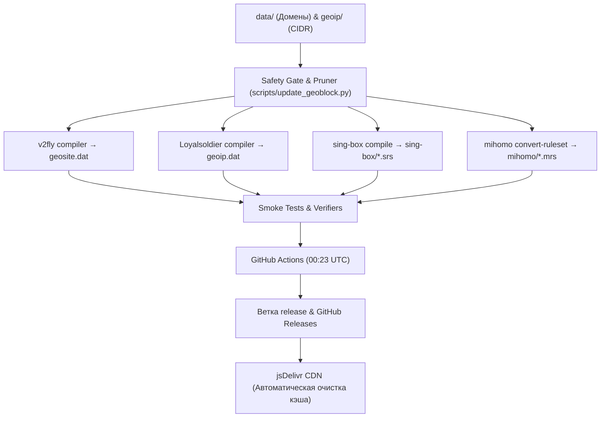

<div align="center">

# 🚀 коридор роутинг

**Автономный сервис умной маршрутизации и раздельного туннелирования (Split Tunneling) для проекта [«коридор»](https://mvrvntn.github.io/koridor/), [Happ](https://happ.su), [INCY](https://incy.cc), [Remnawave](https://docs.rw), [Sing-box](https://github.com/SagerNet/sing-box) и [Mihomo](https://github.com/MetaCubeX/mihomo).**

[](https://github.com/mvrvntn/routing/actions/workflows/update-configs.yml)
[](https://github.com/mvrvntn/routing/releases/latest)
[](https://www.jsdelivr.com/package/gh/mvrvntn/routing)
[](tests/)
[](LICENSE)

**Регион:** 🇷🇺 Россия + 🇧🇾 Беларусь

</div>

---

## ⚡ Как это работает

* 🇷🇺 **Напрямую через локального провайдера (Direct):** Государственные порталы, банки (Сбер, Т-Банк, ВТБ), Налоговая служба, СБП, маркетплейсы (Ozon, WB), сервисы Яндекса, VK, Кинопоиск, сетевые игры (Steam, Epic, Riot) и диагностические чекеры сетевых параметров. Работают с минимальным пингом (RTT) на максимальной скорости домашнего/мобильного провайдера без лишних капч и проверок.
* 🌍 **Через удалённый прокси-узел (Proxy):** Зарубежные медиаплатформы, YouTube, Discord (**включая прямые UDP голосовые серверы**), Telegram, а также исследовательские AI-инструменты (ChatGPT, Claude, Gemini, Perplexity) и внешние сервисы.
* 🍏 **Энергоэффективно (~1.8 МБ RAM):** База сжата алгоритмом агрегации поддоменов (`geosite.dat` ~77 КБ). Снижает нагрузку на CPU смартфона, предотвращает нагрев аккумулятора и системные сбросы сетевого расширения на iOS.
* 🎮 **Оптимизация для гейминга (Low Latency & CDN Bypass):** Игровой голосовой движок Vivox (`vivox.com`), платформы Steam, Battle.net, Epic Games, Riot, Tarkov, Roblox, Call of Duty (Ricochet). Скачивание обновлений и дистрибутивов игр принудительно направляется напрямую (`DIRECT`) на скорости 1 Гбит/с даже при активации VPN для игр, а замер пинга в матчах защищен от задержек Fake-IP (SDR / STUN bypass).
* 🛡 **Аппаратный Safety Gate:** Домены национальных зон `.ru`, `.рф`, `.su` аппаратно изолированы от проксирования.

---

## 📱 Быстрое подключение (Happ & INCY)

> [!IMPORTANT]
> **Основа проекта — умное раздельное туннелирование (Split Tunneling) и оптимизация сетевых маршрутов.**  
> Для повседневного использования на смартфонах и ПК используйте основной профиль **DEFAULT** (или **JSONSUB**).

### 🌟 Основные профили (Раздельное туннелирование / Split Tunneling)

*Оптимизируют сетевой маршрут: локальные сервисы и национальная инфраструктура направляются напрямую через вашего провайдера с минимальным RTT, а международные платформы, AI-инструменты и удаленные медиасервисы (YouTube, Discord) — через выделенный внешний узел.*

| Профиль | Назначение | Happ (iOS/Android/ПК) | INCY (iOS/Android/ПК) |
| :--- | :--- | :--- | :--- |
| **коридор роутинг**<br>*(DEFAULT)* | ⭐️ **Основной / Рекомендуемый.** Умное раздельное туннелирование: банки, маркетплейсы, Госуслуги и игры — напрямую; YouTube, Discord (вкл. голосовые), AI и внешние платформы — через прокси-узел. | [⚡ В 1 клик](HAPP/DEFAULT.DEEPLINK)<br>[📄 JSON URL](HAPP/DEFAULT.JSON) | [☁️ Autorouting](INCY/DEFAULT.AUTOROUTING)<br>[⚡ В 1 клик](INCY/DEFAULT.DEEPLINK) |
| **коридор роутинг • JSONSUB** | 🧩 **Для панелей подписок.** Базовый профиль с изолированными DoH DNS и базами geodata; правила маршрутизации считываются из JSON-конфигурации подписки. | [⚡ В 1 клик](HAPP/JSONSUB.DEEPLINK)<br>[📄 JSON URL](HAPP/JSONSUB.JSON) | [☁️ Autorouting](INCY/JSONSUB.AUTOROUTING)<br>[⚡ В 1 клик](INCY/JSONSUB.DEEPLINK) |

---

### ⚠️ Специфические профили (Специальные сценарии)

> [!WARNING]
> **Внимание! Эти профили являются узкоспециализированными и предназначены для нестандартных условий подключения.**  
> Не включайте их без прямой необходимости.

| Профиль | Назначение | Happ | INCY | Документация |
| :--- | :--- | :--- | :--- | :--- |
| **коридор роутинг • БС**<br>*(WHITELIST)* | 🛡 **Режим высокой сетевой автономии.** Профиль максимальной отказоустойчивости. Пропускает напрямую **исключительно** критическую инфраструктуру РФ (белые списки: Госуслуги, Банки, СБП, связь, маркетплейсы, РЖД). Предназначен для гарантированной доступности ключевых сервисов. | [⚡ В 1 клик](HAPP/WHITELIST.DEEPLINK)<br>[📄 JSON](HAPP/WHITELIST.JSON) | [☁️ Autorouting](INCY/WHITELIST.AUTOROUTING)<br>[⚡ В 1 клик](INCY/WHITELIST.DEEPLINK) | [📄 Манифест](HAPP/WHITELIST.JSON) |
| **коридор роутинг • релокант**<br>*(RELOCANT)* | 🌍 **Обратный роутинг (Reverse Split).** Для тех, кто находится **за пределами РФ** (Сербия, Грузия, ЕС, Турция, СНГ). Весь мировой интернет идёт напрямую на скорости 1 Гбит/с, и **только** сервисы РФ (Госуслуги, Банки РФ, Кинопоиск, Faceit RU) идут через российский прокси-сервер. | [⚡ В 1 клик](RELOCANT/HAPP.DEEPLINK)<br>[📄 JSON](RELOCANT/HAPP.JSON) | [☁️ Autorouting](RELOCANT/INCY.AUTOROUTING)<br>[⚡ В 1 клик](RELOCANT/INCY.DEEPLINK) | [📖 Инструкция для релокантов и роутеров](RELOCANT/README.md) |

### 🚀 Как импортировать

* **Happ:** Скопируйте строку из файла `.DEEPLINK` (начинается на `happ://...`) и откройте её на смартфоне или вставьте в Happ: **Настройки** ➔ **Маршрутизация** ➔ **+** ➔ **Импортировать из буфера**.  
  *Либо укажите прямой URL на JSON:*  
  * Основной: `https://cdn.jsdelivr.net/gh/mvrvntn/routing@main/HAPP/DEFAULT.JSON`  
  * Релокант: `https://cdn.jsdelivr.net/gh/mvrvntn/routing@main/RELOCANT/HAPP.JSON`
* **INCY (Рекомендуется):** В приложении INCY выберите **Маршрутизация** ➔ **+** ➔ **Добавить по ссылке (Autorouting)** и вставьте URL:  
  * Основной:
    ```text
    https://cdn.jsdelivr.net/gh/mvrvntn/routing@main/INCY/DEFAULT.JSON
    ```
  * Релокант:
    ```text
    https://cdn.jsdelivr.net/gh/mvrvntn/routing@main/RELOCANT/INCY.JSON
    ```
  *(Профиль будет обновляться автоматически раз в сутки)*.
* **Shadowrocket (iOS):** В приложении Shadowrocket перейдите в **Конфигурация** ➔ **+** ➔ вставьте URL профиля:
  * Основной: `https://cdn.jsdelivr.net/gh/mvrvntn/routing@main/SHADOWROCKET/DEFAULT.CONF` *(зеркало: [GitHub Raw](https://raw.githubusercontent.com/mvrvntn/routing/main/SHADOWROCKET/DEFAULT.CONF))*
  * Белый список (БС): `https://cdn.jsdelivr.net/gh/mvrvntn/routing@main/SHADOWROCKET/WHITELIST.CONF` *(зеркало: [GitHub Raw](https://raw.githubusercontent.com/mvrvntn/routing/main/SHADOWROCKET/WHITELIST.CONF))*

---

## 💬 100% Работа Discord (WebRTC, Voice, Video)

Если у вас или ваших пользователей возникают проблемы с Discord (вечный статус `RTC Connecting` / `Подключение к RTC`, «Маршрут не найден», заикания звука, дропы демонстрации экрана):

👉 **[Ознакомьтесь с полным руководством по Discord (100% Bulletproof Guide)](docs/DISCORD_FIX.md)**

В репозитории реализовано 4-уровневое отказоустойчивое решение:
1. **Доменные списки (`geosite:discord`)**: 55+ доменов, STUN-серверы, Krisp AI, Quests, Activities.
2. **IP CIDR-диапазоны (`geoip:discord`)**: Cloudflare Anycast (`162.159.128.0/19`), i3D.net (`66.22.192.0/18`), GCP.
3. **Failsafe по порту (UDP `19294–19344`)**: Официальный IANA-диапазон Discord Media перехватывается безусловно во всех клиентах.
4. **Процессный перехват**: Поддержка официального клиента и альтернатив (`Vesktop`, `WebCord`, `ArmCord`, `Legcord`, `Ripcord`, `Dorion`).
5. **Инструкция по настройкам клиента**: Отключение конфликтующего QoS, переключение аудиоподсистемы, защита от утечек IPv6.

<details>
<summary><b>🔧 Быстрые рекомендации по настройке Discord (FAQ / Решение проблем)</b></summary>

* **1. Отключите Quality of Service (QoS) — ОБЯЗАТЕЛЬНО:**  
  *Настройки пользователя ➔ Голос и видео ➔ Дополнительно ➔ «Включить приоритет пакетов (Quality of Service)»* — **Выключить (OFF)**.  
  *(При включенном QoS драйверы виртуальных адаптеров Wintun и домашние роутеры сбрасывают DSCP-метку, из-за чего голос спонтанно падает через 3–5 минут разговора).*

* **2. При «роботизированном» звуке или прерываниях:**  
  *Настройки пользователя ➔ Голос и видео ➔ «Аудиоподсистема»* — переключите со *Standard* на **«Legacy» (Устаревшая)**.

* **3. Если зависает демонстрация экрана (стриминг видео):**  
  *Настройки пользователя ➔ Голос и видео ➔ Экран* — отключите *«Использовать новейший метод захвата экрана»* или отключите *«Аппаратное ускорение H.264»*.

* **4. Не запускайте Zapret / GoodbyeDPI одновременно с VPN:**  
  Одновременная работа драйверов WinDivert (Zapret) и Wintun (VPN-клиенты) вызывает десинхронизацию UDP-пакетов и сброс соединения. Наш роутинг полностью обеспечивает доступ к Discord без сторонних утилит.

* **5. Для администраторов серверов (при задержках подключения к каналу):**  
  В настройках голосового канала укажите регион сервера вручную: **Rotterdam**, **Frankfurt** или **Central Europe** вместо «Автоматически».

Подробный разбор архитектуры и всех опций: [**docs/DISCORD_FIX.md**](docs/DISCORD_FIX.md).
</details>

---

## 🔌 Интеграция с серверными панелями

Готовые проверенные решения и шаблоны конфигураций:

### 1. [Remnawave](ADDON_AUTOROUTING/Remnawave/)
* **Автовыдача для INCY:** В **Subscription ➔ Response Rules** (правило `incy`):
  ```http
  autorouting: incy://autorouting/onadd/https://cdn.jsdelivr.net/gh/mvrvntn/routing@main/INCY/DEFAULT.JSON
  ```
  *(Дополнительные заголовки: `routing-geo-update-interval: 86400` — независимое расписание обновления геофайлов; `routing: off` — принудительный полный туннель без сплита).*
* **Автовыдача для Happ:** В **Subscription ➔ Response Rules** (правило `happ`):
  ```http
  routing: happ://routing/onadd/...
  ```
  *(Актуальную строку берите из [`HAPP/DEFAULT.DEEPLINK`](HAPP/DEFAULT.DEEPLINK) либо настройте автообновление через микросервис [`remnawave-routing-update`](ADDON_AUTOROUTING/Remnawave/README.md#2-автороутинг-для-happ))*.
* **Xray Location (ноды):** [`xray_location_template.json`](ADDON_AUTOROUTING/Remnawave/xray_location_template.json) с защитой `routeOnly: true`.
* **Sing-box:** [`singbox_subscription_template.json`](ADDON_AUTOROUTING/Remnawave/singbox_subscription_template.json).
* **Mihomo / Clash:** [`MIHOMO/`](MIHOMO/README.md):
  * Основной шаблон: [`template_remnawave.yaml`](MIHOMO/template_remnawave.yaml)
  * Режим высокой автономии (Белый список): [`template_whitelist.yaml`](MIHOMO/template_whitelist.yaml)
  * Шаблон для 3x-ui: [`template_3x-ui.yaml`](MIHOMO/template_3x-ui.yaml)
  * Готовый конфиг для клиентов (ПК/смартфоны): [`default.yaml`](MIHOMO/default.yaml)

### 2. [Marzban](ADDON_AUTOROUTING/Marzban/) и [Marzneshin](ADDON_AUTOROUTING/Marzneshin/)
* Единый модуль [`subscription.py`](ADDON_AUTOROUTING/Marzban/subscription.py) для любых типов подписок (JSON и Non-JSON) с переключением профиля через переменную `KORIDOR_ROUTING_SOURCE` (`default`, `whitelist`, `jsonsub`).

### 3. [3x-ui](ADDON_AUTOROUTING/3x-ui/)
* Поддержка кастомных заголовков маршрутизации при отдаче клиентских подписок и готовый шаблон для Mihomo: [`MIHOMO/template_3x-ui.yaml`](MIHOMO/template_3x-ui.yaml).

---

## 💻 Ссылки на скомпилированные базы и Rule-Sets

* **Geodata бинарники (V2Ray/Xray/Happ):**
  * `geosite.dat`: `https://cdn.jsdelivr.net/gh/mvrvntn/routing@release/geosite.dat`
  * `geoip.dat`: `https://cdn.jsdelivr.net/gh/mvrvntn/routing@release/geoip.dat`
* **Sing-box (`.srs`):** `https://cdn.jsdelivr.net/gh/mvrvntn/routing@release/sing-box/<category>.srs`
* **Mihomo (`.mrs`):** `https://cdn.jsdelivr.net/gh/mvrvntn/routing@release/mihomo/<category>.mrs`

---

## 📂 Структура репозитория

```text
├── data/                    # Исходные списки доменов для geosite.dat (category-ru, whitelist, discord...)
├── geoip/                   # Исходные списки CIDR IP для geoip.dat (Discord, Telegram, вайтлисты хостинга)
├── HAPP/                    # Готовые JSON-манифесты и .DEEPLINK для клиента Happ
├── INCY/                    # Готовые JSON-манифесты, .DEEPLINK и .AUTOROUTING для клиента INCY
├── RELOCANT/                # Специфический профиль для релокантов (обратный сплит, роутеры, INCY, Happ)
├── MIHOMO/                  # Шаблоны конфигураций для ядра Mihomo / Clash
├── ADDON_AUTOROUTING/       # Модули интеграции для панелей Remnawave, Marzban, Marzneshin, 3x-ui
├── SHADOWROCKET/            # Готовые профили .CONF и наборы правил .list для iOS
├── tools/                   # Утилиты генерации клиентских правил (Streisand, v2RayNG, sing-box)
├── scripts/                 # Скрипты нормализации и проверки доменных списков (update_geoblock.py)
├── tests/                   # Набор регрессионных и юнит-тестов (Safety Gate, инструменты генерации)
├── docs/                    # Дополнительные руководства (DISCORD_FIX.md)
├── LICENSE                  # Открытая разрешительная лицензия MIT
└── .github/workflows/       # CI/CD пайплайн компиляции геобаз и публикации релизов
```

---

## 🛠️ Утилиты генерации правил (iOS / Android / Desktop)

Для клиентов, требующих импорта правил вручную или через QR:
* **Streisand (iOS):** [`tools/streisand/generate_streisand_link.py`](tools/streisand/generate_streisand_link.py) — генерация ссылки `streisand://`
* **v2RayNG (Android):** [`tools/v2rayNG/generate_v2rayng_routing_qr.py`](tools/v2rayNG/generate_v2rayng_routing_qr.py) — QR-код и JSON для импорта правил
* **sing-box (Desktop/Mobile):** [`tools/singbox/generate_singbox_rules.py`](tools/singbox/generate_singbox_rules.py) — генерация правил маршрутизации со `.srs` бинарниками

Подробная инструкция по запуску: [**Документация tools/**](tools/README.md).


---

## 🛠️ Локальная разработка, архитектура и CI/CD

### 1. Архитектура и поток данных (Data Flow)



* **Safety Gate & Pruning:** Скрипт [`scripts/update_geoblock.py`](scripts/update_geoblock.py) аппаратно изолирует национальные TLD (`.ru`, `.рф`, `.su`), домены критической инфраструктуры и банков от попадания в списки проксирования, а также сворачивает избыточные дочерние поддомены.
* **Сборка бинарных артефактов:** Автоматически компилируются базы `geosite.dat` (Protobuf), `geoip.dat`, `.srs` (бинарные деревья sing-box) и `.mrs` (бинарные деревья Mihomo).
* **Smoke Tests:** Проверяется валидность структуры, целостность синтаксиса и допустимые диапазоны размеров файлов.
* **Публикация и CDN:** Артефакты отправляются в ветку `release`, создается релиз GitHub, а для CDN jsDelivr вызывается `purge` для мгновенной отдачи клиентам.

### 2. Локальная разработка и тестирование

**Установка зависимостей:**
```bash
git clone https://github.com/mvrvntn/routing.git
cd routing
python -m pip install -r requirements.txt
```

**Запуск регрессионных и интеграционных тестов (47 тестов):**
```bash
python -m unittest discover tests -v
```

**Нормализация и санитация списков доменов:**
```bash
python scripts/update_geoblock.py
```

**Проверка синтаксиса конфигураций ядра Mihomo:**
```bash
mihomo -t -f MIHOMO/default.yaml
mihomo -t -f MIHOMO/template_remnawave.yaml
mihomo -t -f MIHOMO/template_whitelist.yaml
```

---

## 💡 Предложить домен или маршрут

Если вы обнаружили, что сервис работает некорректно, блокирует зарубежные IP-адреса или должен направляться напрямую:

* [**📋 Заполнить анкету на добавление/изменение домена**](https://github.com/mvrvntn/routing/issues/new?template=domain_request.yml)

> [!TIP]
> В анкете можно указать домен, выбрать желаемый маршрут (*Direct*, *Proxy*, *Whitelist*, *Relocant*) и описать симптом проблемы. Заявка будет обработана и включена в ближайшую ночную сборку.

---

## ❓ FAQ

<details>
<summary><b>1. Почему голосовые каналы Discord работают без задержек («RTC Connecting»)?</b></summary>

Большинство маршрутизаторов перехватывают только веб-домен `discord.com`. Голосовой трафик Discord передаётся по протоколу UDP напрямую на динамические IP-адреса медиа-серверов. 
В нашем репозитории реализовано 4-уровневое решение:
* **IP-подсети (`geoip:discord`):** полные диапазоны Cloudflare Anycast (`162.159.128.0/19`) и i3D.net (`66.22.192.0/18`).
* **Failsafe по портам UDP `19294–19344`:** диапазон IANA для Discord Media перехватывается безусловно во всех клиентах.
* **Доменные списки (`geosite:discord`):** веб-интерфейс, сигнализация, шлюзы, STUN/TURN и модели Krisp AI.
* **Рекомендация по клиенту:** обязательно отключите пункт *«Приоритет пакетов (QoS)»* в настройках Discord (*Голос и видео ➔ Дополнительно*), чтобы исключить конфликт с сетевыми Wintun-драйверами.

Подробное руководство по настройке клиентов: [**docs/DISCORD_FIX.md**](docs/DISCORD_FIX.md).
</details>

<details>
<summary><b>2. Как убедиться, что локальный трафик идёт напрямую?</b></summary>

Откройте [2ip.ru](https://2ip.ru) или банковское приложение (Сбер, Т-Банк) — там отображается ваш реальный домашний IP-адрес интернет-провайдера.
</details>

<details>
<summary><b>3. Не будут ли перегружаться удаленные шлюзы и серверы?</b></summary>

Нет. Через удаленные узлы проходит исключительно внешний трафик (~10–15%). Весь локальный тяжелый контент (видеосервисы, CDN, скачивание игр в Steam, P2P/торренты) направляется напрямую через домашнего провайдера на максимальной скорости тарифа.
</details>

<details>
<summary><b>4. Чем отличаются профили DEFAULT, JSONSUB, WHITELIST (БС) и RELOCANT?</b></summary>

* **DEFAULT (Основной):** Повседневное раздельное туннелирование: локальные сервисы и диагностические чекеры идут напрямую с минимальным RTT, а международные платформы (YouTube, Discord) и AI-инструменты — через внешний прокси-узел.
* **JSONSUB (Базовый):** Для интеграции с панелями подписок: содержит только DoH DNS и ссылки на скомпилированные базы данных; правила маршрутизации считываются из внешнего JSON-конфига подписки.
* **WHITELIST (БС, Специфический):** Режим максимальной сетевой устойчивости и автономии: прямой приоритетный доступ только к белым спискам критической инфраструктуры РФ.
* **RELOCANT (Релокант, Специфический):** Обратный сплит-туннель для тех, кто находится **за границей**. Весь мировой интернет идёт напрямую, а государственные сервисы РФ, банки, Кинопоиск и серверы Faceit RU идут через российский прокси-сервер. Подробнее: [RELOCANT/README.md](RELOCANT/README.md).
</details>

<details>
<summary><b>5. Как устроена корректная работа банковских приложений, мессенджеров и Госуслуг?</b></summary>

Сервисы определения параметров соединения (более 30 чекеров, включая `browserleaks.com`, `whoer.net`, `ipinfo.io`, `ipwho.is`, `2ip.ru`) принудительно направляются в прямое соединение (`direct`). Приложения банков и сервисы аутентификации обращаются напрямую к оператору связи, что обеспечивает мгновенный вход без задержек и капч.
</details>

<details>
<summary><b>6. Как узнать, какие IP и домены изменились после ночной сборки?</b></summary>

Вся дельта между релизами сохраняется в ветке `release`. Список добавленных и скорректированных подсетей можно увидеть командой:
```bash
git diff origin/release~1 origin/release -- text/direct.txt
```
</details>

---

## 🙏 Благодарности и поддержка разработчиков оригинала

Проект базируется на наработках сообщества и выражает благодарность авторам оригинальных решений:
* **Разработка:** [ristavor](https://github.com/ristavor)
* **Благодарности:** [hydraponique](https://github.com/hydraponique) & [fatyzzz](https://github.com/fatyzzz)
* **Telegram-сообщество проекта:** [t.me/vpnrouting](https://t.me/vpnrouting)

**Поддержать авторов оригинала (донат):**
* `USDT TRC20`: `TMu3N2ZjK5omJ7n3WAj5MNCSM5querBXsR`

---

## 📄 Лицензия (License)

Проект и созданные базы данных правил распространяются под разрешительной свободной лицензией **[MIT](LICENSE)**.

* Вы можете свободно использовать, копировать, модифицировать, объединять, публиковать, распространять и интегрировать наборы правил (geoip.dat, geosite.dat, .mrs, .srs, .json, .conf) в любые сторонние проекты, приложения и сервисы (включая коммерческие VPN-сервисы).
* Единственное условие лицензии: сохранение уведомления об авторских правах и ссылки на исходный репозиторий проекта ([mvrvntn/routing](https://github.com/mvrvntn/routing)).
* Проект предоставляется «как есть» (AS IS), без каких-либо прямых или косвенных гарантий.

---

## ⚖️ Дисклеймер (Legal Disclaimer)

> [!NOTE]
> Настоящий репозиторий представляет собой независимый исследовательский open-source проект для системного администрирования, анализа сетевых протоколов и оптимизации маршрутизации трафика (Traffic Engineering & Split Tunneling).
>
> 1. Проект **не предназначен для преодоления технических мер защиты или ограничений доступа к информации**, не содержит встроенных серверов или прокси-узлов, не оказывает телематических услуг связи и не осуществляет распространение сведений о способах получения доступа к ресурсам с ограниченным доступом.
> 2. Файлы конфигураций содержат технические списки маршрутизации доменных имен и IP-адресов, предназначенные исключительно для снижения сетевых задержек (RTT), распределения нагрузки на каналы связи и обеспечения стабильного прямого доступа к локальным информационным системам (включая государственные порталы, финансовые сервисы и национальную цифровую инфраструктуру).
> 3. Использование представленных материалов регулируется законодательством страны пользователя. Пользователь самостоятельно несет ответственность за соблюдение применимых законов и правил связи.

---

<div align="center">

**[🌐 Официальный сайт «коридор»](https://mvrvntn.github.io/koridor/)**  
*Надежная оптимизация сетевых маршрутов и раздельного туннелирования*

<br>

[⭐ Поставьте Star](https://github.com/mvrvntn/routing), если проект вам помог!

</div>
